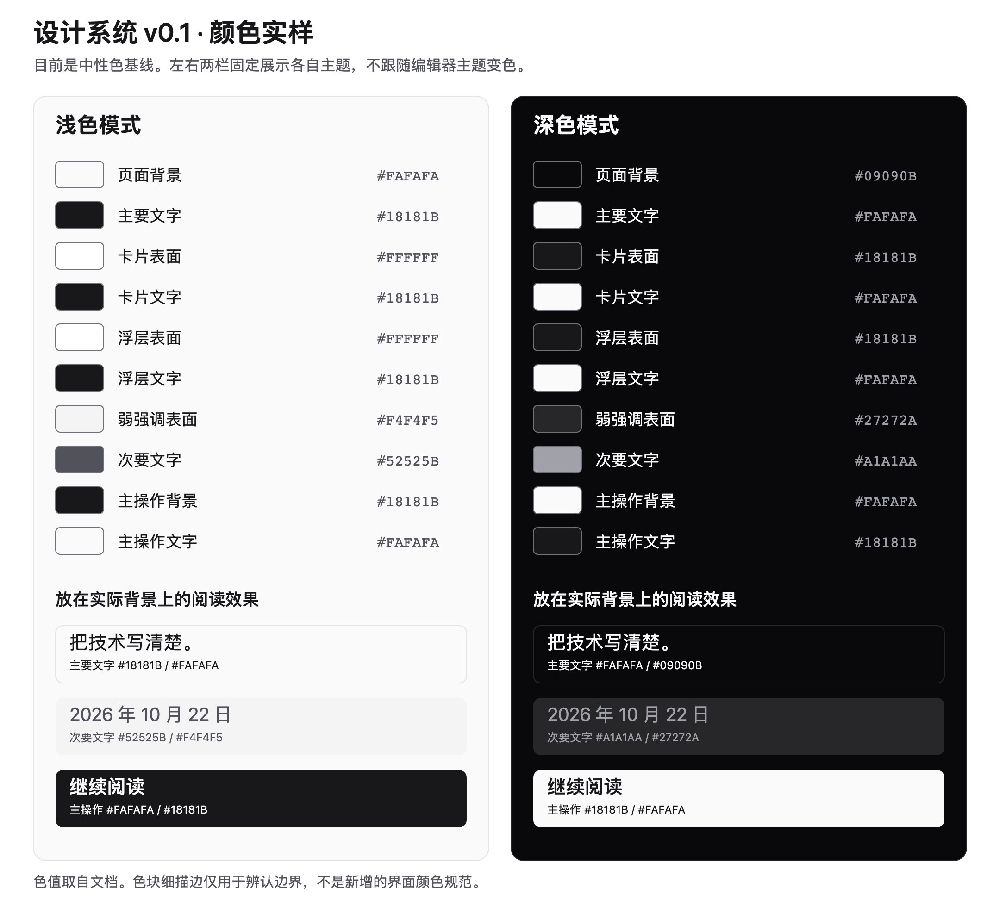

# 设计系统 v0.1

更新日期：2026-10-22。状态：待用户评审的首版基线，尚未应用到界面。

文档入口：[项目文档](./README.md)。技术分层见[技术决策](./technical-decisions.md)，运行边界见[本地开发方案](./local-development.md)。

本规范面向公开文章、手记、作品、导航、搜索、主题和阅读体验。评论、访客登录、后台编辑不属于首期。所有数字和颜色是可讨论的基线，不表示用户已经选定最终视觉，也不沿用此前三轮设计稿。

## 1. 设计原则

参考 Spectrum 用原则验证具体设计决定的方式，形成适合本站的检查标准。下面是本项目的约定，不是对 Adobe 规范的逐条复制。

| 原则 | 为什么需要 | 如何检查 |
| --- | --- | --- |
| 内容优先 | 访客主要阅读技术文章、了解作品，生活记录为辅 | 首要内容能直接找到，装饰不阻断阅读或操作 |
| 层级清楚 | 标题、正文、元信息承担不同任务 | 去掉图片和颜色后，仍能从结构、字号与间距辨认主次 |
| 交互可预期 | 用户不应重新学习常见控件 | 链接负责导航，按钮负责操作，返回与关闭行为一致 |
| 样式一致 | 同一用途不应在不同页面换一套表达 | 同类内容复用语义变量与组件变体 |
| 支持无障碍 | 鼠标、键盘、触控和辅助技术都需要完整信息 | 检查焦点、名称、对比度、缩放与减少动态效果 |

## 2. 设计变量与命名

设计变量用于保存可以复用的设计决定。先区分用途，再决定值，可以在换主题时保持组件含义不变。

| 层 | 保存什么 | 示例 | 使用边界 |
| --- | --- | --- | --- |
| 基础值 | 中性色、字号、间距、圆角等原始尺度 | `neutral-950`、`space-4` | 供语义层选择，页面不直接依赖某个颜色编号 |
| 语义变量 | 一个值承担的界面用途 | `--background`、`--foreground`、`--primary` | 页面与通用组件优先使用这一层 |
| 必要的组件引用 | 某个组件独有、确有必要单独管理的用途 | 按钮背景引用 `--primary` | 不为每个 CSS 属性复制一份组件变量 |

例如，同一个主操作按钮在浅色和深色主题中可以采用不同颜色，但始终引用 `--primary` 与 `--primary-foreground`。不要把按钮写成“使用某一档灰色”，否则换主题时必须逐个查找修改。

落地时使用本站自己的 CSS 语义变量，并与现有 Tailwind 配合。Base UI 不提供预设主题，也不强制变量命名。不在业务页面硬编码颜色；确需特殊视觉时，先说明它属于什么语义角色。不得为了整理变量同时引入新的生成框架。

检查方法：搜索组件中的原始色值，判断是否已有语义变量；检查亮暗主题是否为同一语义定义成对值；确认组件引用没有无意义地重复语义层。

## 3. 颜色、主题与表面

### 核心颜色基线

先用中性色验证层级。品牌色留给用户设计，不预先指定蓝色、紫色或 Adobe 品牌色。表中的十六进制值用于阅读和评审，变量名称是本站首版提案，不是对某个组件库主题的依赖。

下面两张颜色表的每个色号旁都带有本地 PNG 色块，Markdown 预览可以直接看到；源码中的十六进制文字本身仍是文字，不依赖编辑器的颜色装饰功能。大色板用于比较浅色、深色和文字配对。

在 VS Code 中打开本文，按 **Cmd+Shift+V** 查看 Markdown 预览；需要左右对照源码时，先按 **Cmd+K**，松开后按 **V**。也可以直接打开[色板图片](./assets/color-palette.png)放大查看，不需要安装插件。[VS Code 预览说明](https://code.visualstudio.com/docs/languages/markdown#_markdown-preview)

图片由下表色值生成，可编辑源图为 [color-palette.svg](./assets/color-palette.svg)。色值调整时同步更新源图、大色板 PNG 和表格中的小色块，并与表格核对。图中的细描边只是色块边界辅助，不是新增的界面配色。

| 用途 | 项目语义变量 | 浅色 | 深色 |
| --- | --- | --- | --- |
| 页面背景 | `--background` |  `#FAFAFA` |  `#09090B` |
| 主要文字 | `--foreground` |  `#18181B` |  `#FAFAFA` |
| 卡片表面 | `--card` |  `#FFFFFF` |  `#18181B` |
| 卡片文字 | `--card-foreground` |  `#18181B` |  `#FAFAFA` |
| 浮层表面 | `--popover` |  `#FFFFFF` |  `#18181B` |
| 浮层文字 | `--popover-foreground` |  `#18181B` |  `#FAFAFA` |
| 弱强调表面 | `--muted` |  `#F4F4F5` |  `#27272A` |
| 次要文字 | `--muted-foreground` |  `#52525B` |  `#A1A1AA` |
| 主操作背景 | `--primary` |  `#18181B` |  `#FAFAFA` |
| 主操作文字 | `--primary-foreground` |  `#FAFAFA` |  `#18181B` |

`--secondary`、`--accent` 及对应前景色用于次级控件、悬停或选中等具体场景，实际接入组件时再评审数值。这里的 `accent` 表达弱强调交互表面，不自动等于本站品牌色。

### 反馈与边界角色

| 角色 | 首版规则 | 检查方法 |
| --- | --- | --- |
| 成功、警告、错误、信息 | 分别保留语义角色，具体色值待评审；不借用品牌色表达全部状态 | 去掉颜色后，仍有文字或图标说明发生了什么 |
| 错误操作 | 使用项目定义的 `destructive` 等危险操作语义变量 | 危险程度和文案一致，不把所有错误提示都画成强操作按钮 |
| 装饰分隔线 | 表达内容分组，单独定义 `--border` | 不依靠这条线作为识别控件的唯一手段 |
| 输入框边界 | 表达可输入区域，单独定义 `--input` | 对实际背景有足够识别度，不能机械沿用很淡的分隔线 |
| 键盘焦点 | 使用 `--ring` 等明确的焦点样式 | 浅色、深色和相邻表面下都可见，不用 `outline: none` 隐藏 |

主题计划提供浅色、深色和跟随系统三种选择。深色主题按用途重新配对，不能简单反色。当前布局仅跟随系统切换明暗样式，手动主题选择和持久化尚未实现。

### 表面、阴影与层级

页面、普通卡片、浮层是不同用途。普通内容不默认加阴影；浮层可以用轻阴影和边界表达遮挡。提示气泡、菜单和弹窗遵循组件的 Portal 与焦点管理，不在各页面随意堆叠巨大 `z-index`。

阴影和叠放数值在首次实现对应组件时评审。检查时同时打开实际会重叠的浮层，确认关闭按钮、焦点与内容没有被挡住，不能只看一张静态图。

### 静态对比度基线

以下是这六组指定、不透明前景与背景的 sRGB 静态计算，不能替代实际组件、图片背景、透明度与状态检查。

| 配对 | 前景 | 背景 | 对比度 |
| --- | --- | --- | --- |
| 浅色主要文字 |  `#18181B` |  `#FAFAFA` | 16.97:1 |
| 浅色次要文字 |  `#52525B` |  `#F4F4F5` | 7.03:1 |
| 浅色主操作文字 |  `#FAFAFA` |  `#18181B` | 16.97:1 |
| 深色主要文字 |  `#FAFAFA` |  `#09090B` | 19.06:1 |
| 深色次要文字 |  `#A1A1AA` |  `#27272A` | 5.81:1 |
| 深色主操作文字 |  `#18181B` |  `#FAFAFA` | 16.97:1 |

复算方法：将每个 sRGB 通道除以 255 得到 `c`；当 `c <= 0.04045` 时线性值为 `c / 12.92`，否则为 `((c + 0.055) / 1.055) ** 2.4`。亮度为 `0.2126R + 0.7152G + 0.0722B`。对比度为 `(较亮值 + 0.05) / (较暗值 + 0.05)`。表格展示值保留两位小数，判断是否达标使用未舍入值，不能把 4.499:1 四舍五入后算作通过。

## 4. 排版与阅读内容

保留 Geist 与 Geist Mono，中文使用 `PingFang SC`、`Microsoft YaHei`、`sans-serif` 等系统字体回退。字重、字号和行距共同表达层级，不能只靠颜色区分标题与正文。本轮不新增字体下载。

| 角色 | 桌面基线 | 手机基线 | 原因与检查 |
| --- | --- | --- | --- |
| 界面正文 | 16px | 16px | 控件与常规说明保持可读，支持浏览器缩放 |
| 文章正文 | 18px | 17px | 连续阅读使用较宽松尺度，行高均为 1.85 |
| 页面标题 | 32px | 28px | 表达页面主题，长标题自然换行，不强制两行截断 |
| 正文二级标题 | 24px | 24px | 区分章节，语义使用 `h2` |
| 正文三级标题 | 20px | 20px | 区分小节，语义使用 `h3` |
| 元信息 | 12–14px | 12–14px | 日期与说明较弱，但不能过淡；14px 为常规基线，12px 仅用于简短辅助信息 |

数值以根字号 16px 为评审基准，未来用相应 `rem` 表达可缩放文字。标题建议使用 600 字重、正文 400，最终以中英混排的实际字形评审，不引入额外字体文件凑齐字重。

| 内容 | 规则 | 检查方法 |
| --- | --- | --- |
| 中文段落 | 自然换行，不强制两端对齐；段落之间使用统一间距 | 检查中英混排、数字、括号与长句，不出现异常字间距 |
| 标题与锚点 | 层级不跳级，锚点可用键盘访问 | 点击目录后目标可见，不能被导航遮住 |
| 链接 | 与正文可区分，悬停与焦点状态明确 | 不依赖颜色作为唯一线索，链接文字说明目的地 |
| 列表 | 保留有序或无序语义与缩进 | 检查多行、嵌套和窄屏，序号不被裁切 |
| 引用 | 使用 `blockquote`，通过缩进或边界表达引用 | 与正文可区分，但不把引用变成整页最强视觉元素 |
| 行内代码 | 使用等宽字体，保持句子的阅读节奏 | 长标识符不撑破正文，不能误当按钮 |
| 代码块 | 保留代码空白与语义，超宽内容在代码区域内滚动 | 页面本身无横向溢出，高亮颜色在两种主题下可读 |
| 宽表格 | 保留表头与单元格语义，局部容器处理横向滚动 | 手机能访问完整内容，不缩成不可辨认的小字 |
| 图片与说明 | 保留比例，说明与图片关联；内容图默认完整呈现 | 替代文本有意义，加载失败时仍可理解关联内容 |

封面可以裁切，但必须明确焦点与比例。头像保持比例；装饰图使用空替代文本。图标使用统一体系，具体图标库在接入时单独确认；装饰图标不重复朗读，图标按钮有可访问名称。缺少实际图片时向用户索取，不用 CSS 或 SVG 猜画替代素材。

## 5. 布局、尺寸与响应式

2026-10-22 已实现布局骨架：整体最大宽度 72rem；1024px 起为左栏 14rem、中间自适应、右栏 20rem；640–1023px 为左栏 12rem 与中间内容；小于 640px 时导航置顶、内容单列。桌面两条分隔线支持鼠标拖动与键盘方向键调整；左、中、右栏最小宽度分别为 12、20、16rem。刷新或跨越桌面断点后恢复默认宽度，不保存、不折叠。左右侧栏在桌面吸顶，超高时可独立滚动。当前栏内横向留白在手机为 16px、640px 起为 24px。以上是本轮实际实现，下表其余数值仍为待评审基线。

间距用于表达归属关系。元素之间、组件之间和章节之间分别选择尺度，不能让所有间距都相同。

| 项目 | 首版规则 | 检查方法 |
| --- | --- | --- |
| 间距尺度 | 4、8、12、16、24、32、48、64、96px | 相似关系使用相同尺度；不为单个页面随意增加新档位 |
| 页面最大宽度 | 72rem | 大屏内容不无限拉长，剩余空间作为外侧留白 |
| 正文最大宽度 | 42rem | 测试长段落，不因侧栏或宽屏变成整屏长行 |
| 页面边距 | 小于 768px 为 16px，768–1023px 为 24px，1024px 起为 32px | 窄屏不贴边，浮层和控件不越界 |
| 断点 | 640、768、1024、1280px | 与 Tailwind 断点保持一致，组件按实际容器需要重排 |
| 圆角尺度 | 6、8、10、14px 与全圆角 | 默认控件 8px、面板 14px；形状表达用途，不所有元素都用胶囊形 |
| 操作区域 | 常见触控操作以至少 44×44 CSS px 为目标 | 命中区域不重叠，小图标不意味着小点击区 |

布局在 320px 开始验证，同时覆盖 375、768、1024、1280px 和文字放大。断点不代替连续宽度检查：长中文标题、长 URL、空内容和多项导航都要测试。

## 6. 组件规范

以下是组件与内容样式的参考范围，不是安装或补造清单。第一批从 Base UI Button 的行为和自己的样式开始学习。保留 Base UI 的基础交互，不手写替代焦点管理，也不为每个组件再包一层无必要的项目组件。shadcn/ui 仅在有合适实现时按需参考或选用。

### 统一说明模板

每个实际引入的组件补充：用途、结构、尺寸、变体、适用状态、键盘与触控行为、语义变量、正确示例、错误示例和验收结果。状态按组件能力选择，不给静态卡片强加选中状态。

| 状态 | 规则 | 如何检查 |
| --- | --- | --- |
| 默认、悬停、按下 | 操作反馈不改变周围布局 | 鼠标移入、按下时不会跳动或误触 |
| 焦点 | 与悬停不同，键盘焦点清楚可见 | 仅用 Tab 和键盘完成操作 |
| 禁用 | 使用真实禁用语义，不仅降低透明度 | 不能触发操作，必要的原因说明仍可获得 |
| 加载 | 保留操作上下文，防止不应重复的提交 | 慢响应下不重复触发，完成或失败后能恢复 |
| 错误 | 指明问题和可采取的下一步 | 文字与控件正确关联，不只显示红色 |
| 选中、展开 | 暴露对应状态，保持内容和触发器关系 | 样式与 `aria-selected`、`aria-expanded` 等实际语义一致 |
| 只读 | 与禁用区分，信息仍能阅读或复制 | 不能编辑，但不无故移除阅读和选择能力 |

### 组件用途、结构和变体

Base UI 不预设按钮高度、圆角或视觉变体，这些由本站设计变量与样式决定。容器按内容适配；常见触控操作遵循上一节的命中区域目标。

Button、Avatar、Separator、Input、Field、Tabs、Menu、Dialog、Drawer、Tooltip 对应可用的 Base UI 交互基础。Badge、Card、Skeleton、Empty、Pagination、Alert 在下表中是内容或样式模式，不代表 Base UI 提供这些同名组件。暂时没有需求就不实现；简单内容使用语义 HTML 和样式即可，不提前创建同名组件库。

| 组件 | 用途与结构 | 尺寸、变体及适用状态 |
| --- | --- | --- |
| Button | 一个操作，由标签和可选图标组成 | 按需使用主操作、次操作、描边、弱化、危险、链接外观；覆盖默认、焦点、禁用和需要时的加载 |
| Avatar | 表示作者，由图片与失败回退组成 | 大小按作者行或个人介绍语境评审；图片缺失有文本回退，静态头像不增加按钮状态 |
| Badge | 简短分类或状态标签 | 分类采用低强调，重要状态额外有文字；静态标签没有点击和选中行为 |
| Card | 组织真正属于一组的内容，可含标题、正文和操作区 | 内容自适应，面板圆角基线 14px；有交互时由内部链接或按钮承担 |
| Separator | 表达内容分组或区域边界 | 水平或垂直；区分语义分隔与纯装饰，不增加交互状态 |
| Skeleton | 在内容加载时保留大致结构 | 形状随目标内容，减少动态效果时静止；容器另提供加载语义 |
| Empty | 说明没有内容或没有匹配结果 | 由标题、必要说明和可选操作组成；区分首次为空与筛选为空 |
| Input | 搜索或短文本输入 | 使用合适类型、可见标签；覆盖焦点、只读、禁用和需要时的错误 |
| Field | 将标签、输入、说明和错误组织成一组 | 不单独制造另一套输入样式；内容和错误说明正确关联 |
| Tabs | 切换同一上下文的不同内容面板 | 选中项与面板关联，面板尺寸由内容决定；不替代所有跨页面导航 |
| Menu | 收纳次要操作，由触发器和菜单项组成 | 保留官方焦点和键盘行为，明确禁用项；不用悬停作为唯一打开方式 |
| Pagination | 在同一内容集合中切换页码 | 使用导航链接和当前页语义，边界页明确不可继续的方向 |
| Dialog | 需要聚焦处理的局部任务 | 包含标题、必要说明、正文与关闭操作；边界适配窄屏 |
| Drawer | 从侧边展开的补充内容或移动导航 | 保留弹层的标题、关闭和焦点语义；方向按具体场景确定 |
| Tooltip | 补充已经可识别的操作说明 | 鼠标与焦点可触发，内容简短；不能承载唯一的必要说明 |
| Alert | 呈现页面内重要反馈 | 标题、说明和可选操作；状态明确，不把常驻说明都设为紧急播报 |

### 组件行为与使用检查

表中的变量族指第 2、3 节语义，不代表依赖已经安装。新增状态变量时同步记录亮暗配对。

| 组件 | 键盘与语义检查 | 变量与正确用法 | 避免 |
| --- | --- | --- | --- |
| Button | Enter、Space 可操作；图标按钮有名称 | 主操作用 `primary` 配对，焦点使用 `ring` | 为同级操作全部使用最强强调；用普通 div 代替按钮 |
| Avatar | 替代文本与邻近作者名不重复；可点击时由链接承载 | 图片框与回退文字引用 surface、foreground | 错误图片时显示破图或虚构人物信息 |
| Badge | 状态不只靠颜色；若需要筛选，改用有交互语义的控件 | 分类引用 muted 配对，反馈引用对应状态角色 | 把看似按钮的静态标签放进 Tab 顺序 |
| Card | 标题层级合理，内部操作的焦点顺序清楚 | 引用 card 配对、border；一组相关内容用一张卡片 | 嵌套整卡链接和内部按钮，造成交互冲突 |
| Separator | 装饰分隔不重复干扰朗读 | 使用 border，不把它当作输入控件边界 | 用分隔线代替标题与内容分组 |
| Skeleton | 占位图形不逐个朗读，加载状态由容器表达 | 使用 muted 与表面变量 | 闪烁、永不停下的动画，或把错误继续画成加载 |
| Empty | 说明可读，恢复或重置操作可用键盘触达 | 使用 foreground 与 muted-foreground | 把请求失败描述成“没有文章” |
| Input | 标签关联；输入不触发意外导航；文本可选中 | 使用 input、background、foreground、ring | 只用 placeholder 当标签；清除用户输入后才报告错误 |
| Field | 说明与错误通过组件的关联机制连接输入 | 标签与说明使用对应文字层级 | 错误只出现在页面顶部且无法找到对应输入 |
| Tabs | 保留方向键、焦点与选中行为，面板关系准确 | 使用 surface、accent 配对与 ring | 改写组件语义，导致视觉选中与实际面板不一致 |
| Menu | 键盘打开、方向键移动、Escape 关闭并恢复焦点 | 使用 popover 配对、ring 和状态变量 | 把完整复杂表单塞进菜单项 |
| Pagination | 当前页有 `aria-current`，页码与前后页有清晰名称 | 使用 foreground、primary、muted 配对 | 页码变化后显示上一页的内容却不说明加载状态 |
| Dialog | 焦点进入、限制在弹窗内、关闭后恢复；Escape 行为可预期 | 使用 popover 配对、遮罩与必要层级 | 缺少标题、隐藏唯一关闭方式、改坏基础焦点管理 |
| Drawer | 键盘、关闭和焦点检查同 Dialog | 使用表面与边界变量；窄屏可访问所有操作 | 仅允许拖动关闭，或让内容进入不可访问区域 |
| Tooltip | 聚焦也能获取提示，可关闭，不挡住触发器 | 使用 popover 配对及对应文字尺度 | 把关键错误、长文或唯一操作入口藏在气泡里 |
| Alert | 根据紧急程度选择播报方式；操作有清晰名称 | 使用相应反馈角色和前景色 | 只有颜色没有文字，或反复播报无变化的内容 |

## 7. 交互与内容状态

本节描述能力，不预设尚未核对的后端字段或接口格式。

| 模式 | 规则与原因 | 如何检查 |
| --- | --- | --- |
| 站点导航 | 当前区域可识别，链接与返回行为一致；已实现文字式 Base UI Navigation Menu，桌面左侧优先、空间不足翻到右侧，手机下方弹出；鼠标离开延迟 500ms 关闭，移入子菜单或返回触发项保持打开 | 直接进入、刷新、浏览器返回和键盘导航都能找到位置 |
| 搜索 | 保留关键词，区分查询中、无匹配和请求失败 | 连续修改查询时不显示过期结果；失败时仍可重试或修改条件 |
| 分页 | 保留当前集合与筛选上下文，当前页明确 | 检查首尾页、刷新、返回及慢请求，避免页码和内容脱节 |
| 文章目录 | 使用真实标题层级与锚点 | 长标题、无目录文章、跳转目标被遮挡的情况都检查 |
| 主题切换 | 三种选择含义清楚，初始渲染与客户端状态一致 | 刷新及系统主题变化不出现明显闪烁或不可读状态 |
| 加载 | 在需要时保留结构和已有内容，说明正在发生什么 | 模拟慢响应，避免整个页面反复清空 |
| 空内容 | 说明是尚无内容还是没有匹配结果 | 给出适当的返回、清除条件或继续浏览入口 |
| 错误与重试 | 告知可理解的原因和下一步，尽量局部呈现 | 单个区块失败不让仍可阅读的内容一起消失 |

## 8. 动效规范

业务动效使用 Motion for React。它应帮助理解状态或位置变化，不承担内容是否可访问的前提条件。

| 类型 | 首版时长基线 | 用途与检查 |
| --- | --- | --- |
| 快速反馈 | 120ms | 简短状态变化；检查操作发生后能及时感知 |
| 一般过渡 | 180ms | 常见进退场；检查内容和操作不等待动画结束 |
| 较明显变化 | 240ms | 较大布局或位置变化；检查路径是否有助于理解 |

这些时长是评审起点，不强制所有效果同速。进入、退出、布局变化分别说明起止状态，缓动参数在第一个实际动效单元里结合距离和用途确定，不提前制造一整套弹簧参数。

- 连续输入或快速点击可以打断、反向或更新动画目标，不把每次操作排成队。
- 卸载时清理动画和事件；动画不抢焦点，不改坏 Base UI 的打开与关闭语义。
- 同一元素的同一属性只由一个机制控制，不让 Motion 与组件自带过渡竞争。
- 尊重系统减少动态效果设置，减少位移、缩放和滚动效果后，信息与操作仍完整。
- 复杂时间线、滚动联动和精细编排出现明确需求后，再单独评估 GSAP。不提前安装。

检查方法：正常速度、快速连续操作、动画中途反向、组件卸载和减少动态效果都要观察。单次完整播放流畅不等于交互正确。

## 9. 无障碍与文案

本项目以 WCAG AA 的相关要求作为检查基线，不因引用规范就声称已经合规。

- 正常文字与实际背景至少达到 4.5:1；符合大文字条件的文字至少 3:1。识别控件和状态所必需的非文字元素检查 3:1。装饰线不与功能边界混为一谈。
- 焦点清楚可见且不被浮层或固定导航挡住。键盘可以完成鼠标能完成的必要操作。
- 使用正确的标题、链接、按钮、列表、表格和表单语义。图标按钮、输入和弹窗有名称。
- 支持文字缩放和减少动态效果，不能用固定高度裁掉中文标签或说明。
- 状态不能只靠颜色。错误说明具体问题及下一步，不显示内部堆栈或敏感信息。
- 加载、错误、空结果使用不同文案。未完成的动作不能提示成功，不能虚构阅读量、评论或用户身份。

正式组件验收同时包含浏览器检查与人工键盘检查；静态颜色计算只是其中一项。

## 10. 维护与评审

增加或修改规范前，先说明它解决的实际问题、受影响组件以及已有规则为什么不足。用户确认后只改当前学习单元，同时更新规范与验收记录。

首次评审先讨论颜色语义和排版。品牌色、反馈色值、边界与阴影数值、具体缓动和页面构图仍是后续评审项，不由实现者默认为用户已批准。

首次交付仅为文档；随后用户授权实现三栏布局骨架，范围见第 5 节。未创建组件展示页或安装依赖，不自动开始整站 UI。后续组件检查记录实际组件和场景，不把类型检查、截图或文档存在当成行为已通过。

## 参考

- [Spectrum 设计原则](https://spectrum.adobe.com/getting-started/principles)：用原则检查具体选择。
- [Spectrum 设计变量](https://spectrum.adobe.com/foundations/design-data)：表达可复用的设计决定。
- [Spectrum 排版体系](https://spectrum.adobe.com/foundations/typography/typography-system)：用字号、字重和颜色表达信息层级。
- [Spectrum 间距规范](https://spectrum.adobe.com/foundations/layout-and-structure/spacing/spacing-overview)：用距离表达关系和边界。
- [Base UI 样式指南](https://base-ui.com/react/handbook/styling)：自行定义外观与组件状态样式。
- [Base UI 组件目录](https://base-ui.com/react/components)：核对实际组件名称与能力。
- [Motion 无障碍指南](https://motion.dev/docs/react-accessibility)：减少动态效果的处理。
- [WCAG 2.2](https://www.w3.org/TR/WCAG22/)：文字、非文字对比度、焦点、输入和交互的验收依据。
- [文字对比度解释](https://www.w3.org/WAI/WCAG22/Understanding/contrast-minimum.html)与[非文字对比度解释](https://www.w3.org/WAI/WCAG22/Understanding/non-text-contrast.html)：核对阈值、适用对象和例外。
